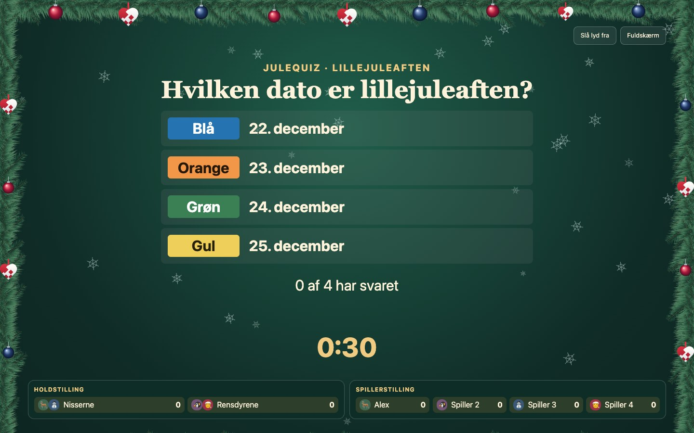
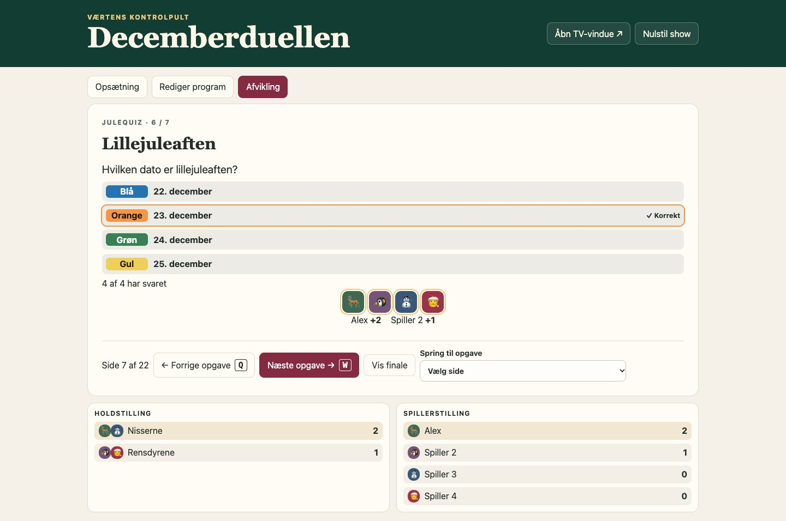

# Decemberduellen

Et dansk julegameshow til julefrokosten eller en aften med familie og venner. Spil julequiz, musikquiz og små udfordringer, og følg pointene på storskærmen i Decemberræset.

**[Åbn Decemberduellen](https://marcuspoulsen.github.io/decemberduellen/)**

1. Gå til **Opsætning**, vælg op til fire hold og otte spillere i alt, navngiv dem, og gem holdene.
2. Vælg **Åbn TV-vindue** fra kontrolpulten. Flyt vinduet til den anden skærm, og vælg **Fuldskærm**. Brug samme browser og profil til begge vinduer.
3. Start spillet under **Afvikling**. Som vært styrer du nedtælling, facit, point og finale. Under **Rediger program** kan du tilpasse spørgsmål, point og rækkefølge.
4. Vælg **Jeg har ikke buzzere** i Opsætning for at bruge tasterne **1–8**, eller klik på spillerknapperne i almindelige buzzerrunder. Ved spørgsmål med farvekodede svar registrerer værten svarene i den rækkefølge, de bliver givet.

Fanen **Guide** viser, hvordan du bygger dit show. Gem hold og hver opgave, når du redigerer. Program og fremdrift gemmes i browserens lokale lager (localStorage) og åbnes igen i samme browserprofil på samme enhed. Musiknumre afspilles manuelt via Spotify. Vælg **Aktivér lyd** i TV-vinduet for at høre julemusikken og finalens lydeffekter. Baggrundsmusikken holder automatisk pause under Musikquiz og vender tilbage i næste del af showet.

## Lokal udvikling

Servér repositoryets rod med en lokal HTTP-server, og åbn adressen i din browser. Kør `npm test` med Node.js for at teste pointberegning og spilovergange.

## Skærmbilleder

